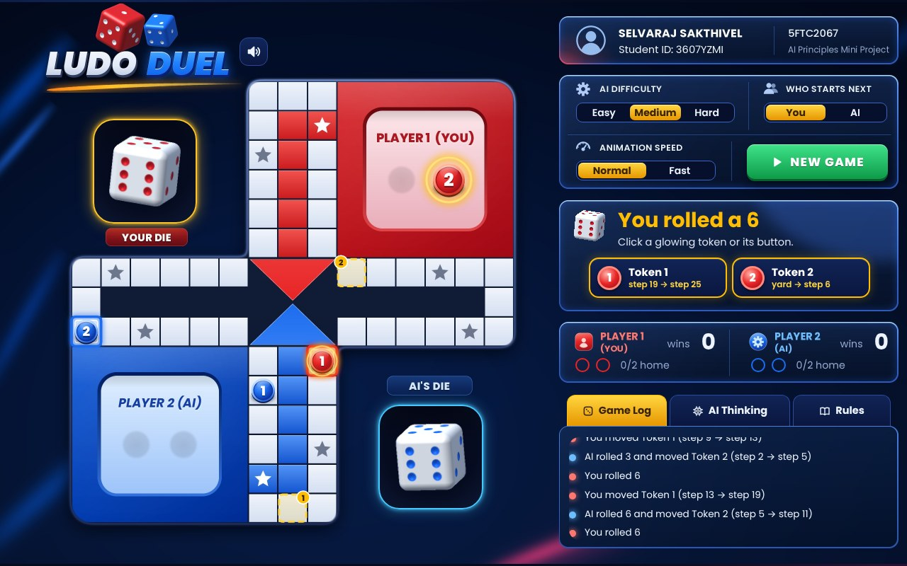
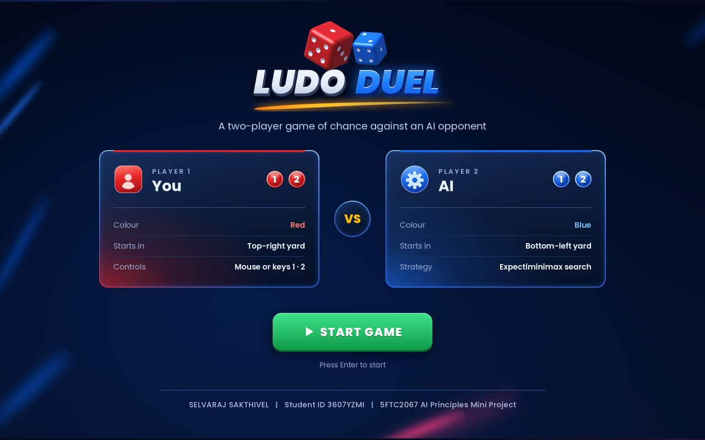
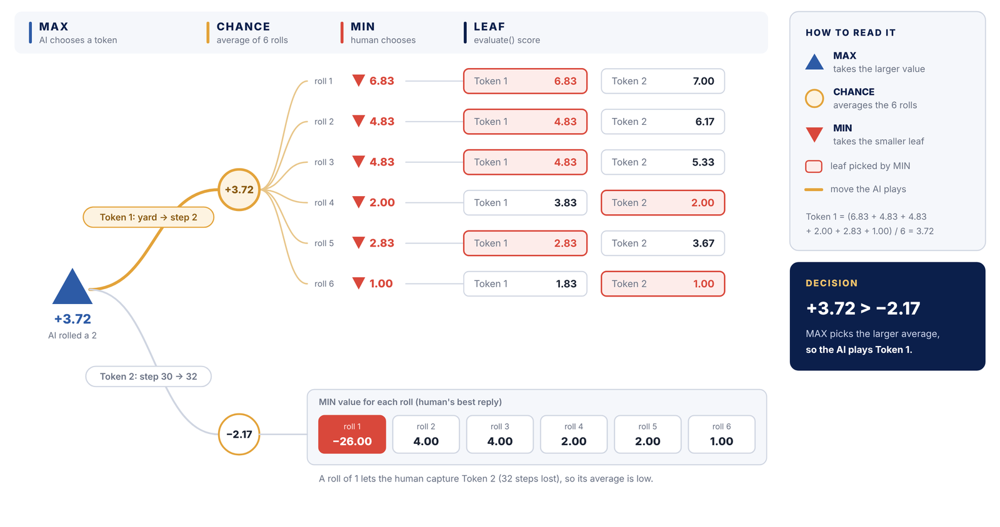
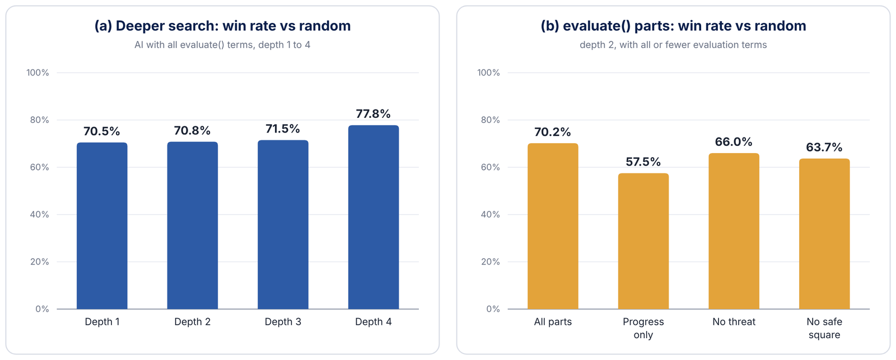
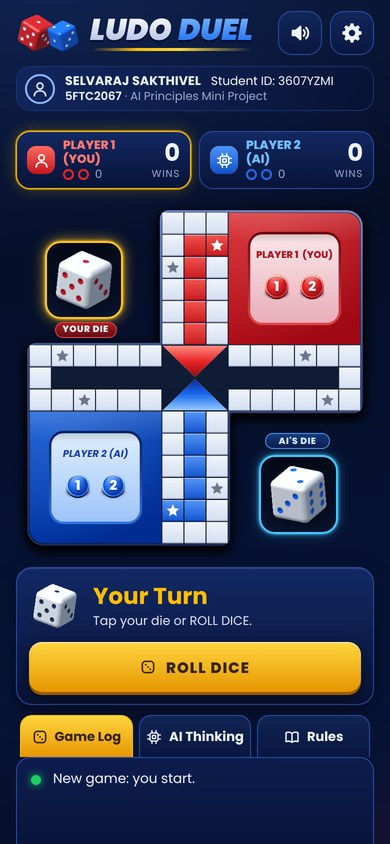

<h1 align="center">🎲 Ludo Duel</h1>

<p align="center">
  <b>A two-player game of chance: you race a computer opponent that plans every move with expectiminimax search.</b><br>
  Desktop version in Python (Tkinter) · Web version playable on any computer or phone
</p>

<p align="center">
  <a href="https://selvarajsakthivel.itch.io/ludo-duel"><b>▶ Play it now on itch.io</b></a>
</p>

<p align="center">
  
</p>

| | |
|---|---|
| **Name** | SELVARAJ SAKTHIVEL |
| **Student ID** | 3607YZMI |
| **Module** | 5FTC2067 Artificial Intelligence Principles, Mini Project |
| **Published game** | https://selvarajsakthivel.itch.io/ludo-duel |

---

## Play on your phone

Scan the code to open the web version. Nothing to install.


---

## Contents

- [The game](#the-game)
- [How to play](#how-to-play)
- [How the computer opponent thinks](#how-the-computer-opponent-thinks)
- [Results](#results)
- [Run it yourself](#run-it-yourself)
- [Project structure](#project-structure)
- [Testing](#testing)
- [Credits](#credits)

---

## The game

Ludo Duel is classic Ludo for two players. **You are red** (top-right yard) and the **computer is blue** (bottom-left yard). Each player has two tokens. The die decides how far a token moves, so every turn mixes **luck** (the roll) with a real **choice** (which token to move). That mix of chance and choice is what makes it a good game for an expectiminimax player.

<p align="center">
  
</p>

The start page shows both players. Player 1 can type a name; it is then used in the score card, the status line and the game log.

## How to play

1. **Roll** the die (click the die, press **Space** or **Enter**).
2. **Choose** a token: click a glowing token, or press **1** or **2**.
3. The token **hops** forward square by square along the shared 52-square ring.
4. Land on an opponent's token on a normal square to **capture** it: it goes back to its yard.
5. The **2 START squares and the 6 star squares are safe**: no capture there.
6. After the ring, each token walks its own 5-square home column to the **FINISH** in the centre.
7. The first player to bring **both tokens** to FINISH wins.

Simplified rules keep the game fast: no 6 is needed to leave the yard, a 6 gives no extra turn, and a roll that overshoots FINISH stops on FINISH.

| Key | Action |
|---|---|
| Space / Enter | Roll the die |
| 1, 2 | Move token 1 or 2 |
| N | New game |
| M | Sound on / off |

**Settings:** three difficulty levels (Easy, Medium, Hard), who starts the next game, and normal or fast animation. The **AI Thinking** tab shows the value the computer computed for each of its moves.

## How the computer opponent thinks

The computer uses **expectiminimax**: minimax with extra **chance nodes** for the die.

| Node | Who | What it does |
|---|---|---|
| MAX | Computer | picks the token with the highest value |
| CHANCE | Die | averages the six faces (1/6 each) |
| MIN | You | assumes you pick the reply that is worst for the computer |

At the search limit, `evaluate()` scores the position for the computer:

```
score = (my progress − opponent's) + (my safe tokens − opponent's) + threat
```

**Threat** is the progress a capture on the next roll would cost, divided by 6 because exactly one die face is needed. A win scores +1000 and a loss −1000.

| Level | Looks ahead | Notes |
|---|---|---|
| Easy | 1 move | plays a random token 40% of the time |
| Medium | 2 moves | |
| Hard | 4 moves | still answers in about 14 ms per move |

**Example turn (Medium).** The computer rolled a 2. Moving Token 1 out of the yard averages **+3.72**; moving Token 2 averages **−2.17**, because it would stop just in front of a red token and a roll of 1 would capture it. MAX picks the larger value, so the computer plays Token 1.

<p align="center">
  
</p>

## Results

`experiments.py` plays 400 games per test, swapping seats and who moves first.

<p align="center">
  
</p>

- The computer wins **70–78%** of games against a random player. Luck still gives the random player 22–30% of the wins.
- The evaluation matters more than the depth: progress alone wins 57.5%, all evaluation terms 70.2%.
- Depth 4 against depth 1 is close to even (50.5%), because with two tokens the dice decide much of the game.

## Run it yourself

**Web version.** Open `web/index.html` in any browser. It is one self-contained file with its pictures and sounds inside.

**Desktop version** (Python 3):

```bash
pip install -r requirements.txt   # Pillow, NumPy
python ludo_main_gui.py
```

Or open the folder in PyCharm and press **Run** on `ludo_main_gui.py`.

## Project structure

Each file has one job. The rules know nothing about the screen or the computer player, so each part can be tested on its own.

| File | Job |
|---|---|
| `ludo_logic.py` | Rules: game state, legal moves, capture, winner |
| `ai.py` | Expectiminimax search, `evaluate()`, random player |
| `ludo_main_gui.py` | Desktop window (Tkinter): game loop, animation, start page |
| `ui_art.py`, `ui_dice.py`, `ui_kit.py` | Board, pawns and the 3-D die (Pillow, NumPy) |
| `ui_start.py`, `ui_sound.py` | Start page with the name box; sound effects |
| `experiments.py` | Plays many games to measure the computer player |
| `web/index.html` | Web version (JavaScript port of the same rules and search) |
| `fonts/`, `sounds/` | Fonts and sound effects used by the desktop game |

<p align="center">
  
</p>

## Testing

```bash
python ludo_logic.py    # plays 1,000 random games as a self-test
python experiments.py   # measures the computer player (takes a few minutes)
```

The self-test checks that every game ends with a winner and that every token stays within progress 0–57. The JavaScript version was checked against the Python version on 3,900 recorded moves and 700 search positions.

## Credits

- Sound effects: [Kenney](https://kenney.nl) (CC0)
- Fonts: Poppins and Lilita One (SIL Open Font License, see `fonts/`)
